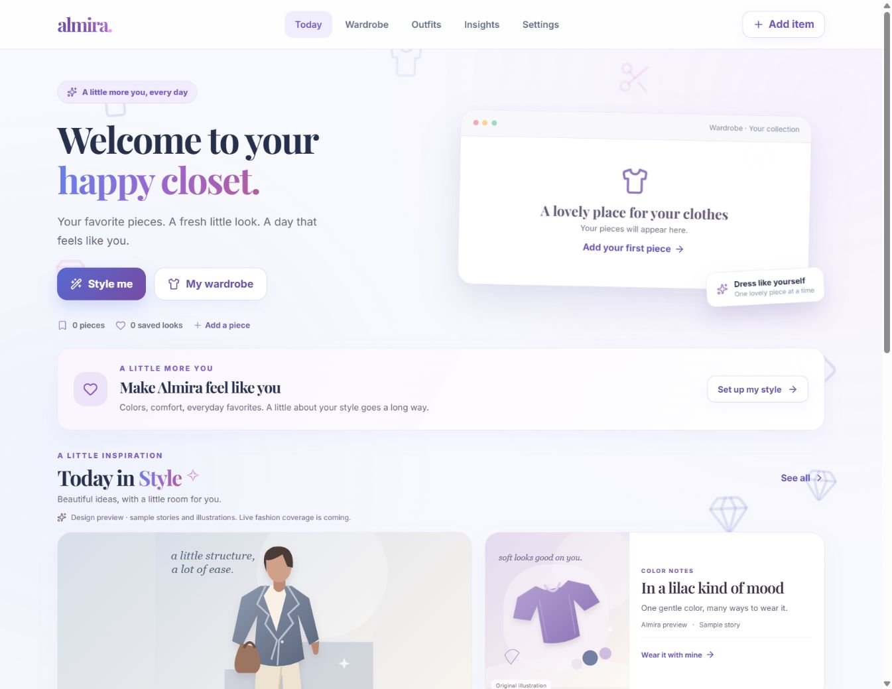

# Almira

**Your style, organized.** A responsive, unisex wardrobe companion that helps people rediscover the clothes they own, build outfits and keep their fashion preferences in their own hands.

Built as a student portfolio project with **React, TypeScript and Vite**, preserving its original purple gradients, glass cards and playful fashion illustrations. The project targets free-tier services with a ₹0 service budget.



## Features

- Local wardrobe with photos, search, categories, favorites and editing.
- Outfit builder, saved looks, wear logging and basic rewear insights.
- Quick styling using owned pieces, occasion, mood and supported color preferences.
- Optional style profile and editable, user-confirmed fashion memories.
- Responsive phone/desktop UI, installable app assets and a built-in user guide.
- JSON backup export/import, including profiles and memories.

## Current status

**Testing build.** Guest wardrobe flows work without an account. Supabase email/password UI and manual cloud profile Save/Load are implemented, with database setup applied to the owner's project. Signed-in profile sync and two-account isolation still need live verification.

Wardrobe, outfits, wear history and photos currently stay on each device. Automatic cloud sync, live Groq styling, feedback learning and sourced fashion photography are unfinished. Today in Style is explicitly labeled sample content with original illustrations. No AI key belongs in browser configuration.

## Run locally

Use Node.js **24** (22.18+ supported) and **pnpm 11.19.0**.

```bash
git clone https://github.com/himani-2-git/almira.git
cd almira/almira-web
pnpm install --frozen-lockfile
pnpm dev
```

Open the URL Vite prints. No keys are required for the guest experience. For account testing, copy `.env.example` to `.env.local`, fill only the public Supabase URL/publishable key, and follow [connected setup](docs/setup.md).

```bash
pnpm check          # Tests and frontend/backend TypeScript
pnpm build          # Production files in dist/
pnpm preview        # Preview the production build
pnpm docs:generate  # Refresh the guide and combined setup SQL
```

## Deploy and test with friends

Use **Cloudflare Pages Free** connected to this GitHub repository. The [deployment guide](docs/deployment.md) covers the first push, exact build settings, public account setup and automatic redeploys. Friends can test guest flows first and report issues through the [bug form](https://github.com/himani-2-git/almira/issues/new/choose).

Fix on a branch → run checks → review a preview → merge to `main` → Cloudflare rebuilds the testing site. Refresh the app to receive a deployed update. Supabase migrations and Edge Functions have a separate deployment step.

## Project structure

```text
.github/                 CI, bug report and pull request templates
almira-web/
  src/                   React UI, local storage and styling
  public/                Icons, web manifest, cache worker and hosting headers
  supabase/              Private database migrations and prepared AI function
  scripts/               Guide/SQL generation and connection checks
  tests/                 Profile, styling, server and cache regression tests
docs/                    Usage, deployment, setup and product roadmap
```

## Documentation

- [User guide](docs/user-guide.md) · also in Settings → How to use Almira
- [Deployment guide](docs/deployment.md)
- [Supabase and Groq setup](docs/setup.md)
- [Roadmap](docs/roadmap.md) and [product requirements](docs/product-requirements.md)
- [Original rebuild decision](docs/decisions/typescript-rebuild.md)
- [Contributing](CONTRIBUTING.md) and [security reports](SECURITY.md)

The owner's legacy PHP recovery archive, personal exports, secret configuration, dependencies and generated builds are excluded from Git. Only source, empty configuration examples and project documentation belong in the repository.
